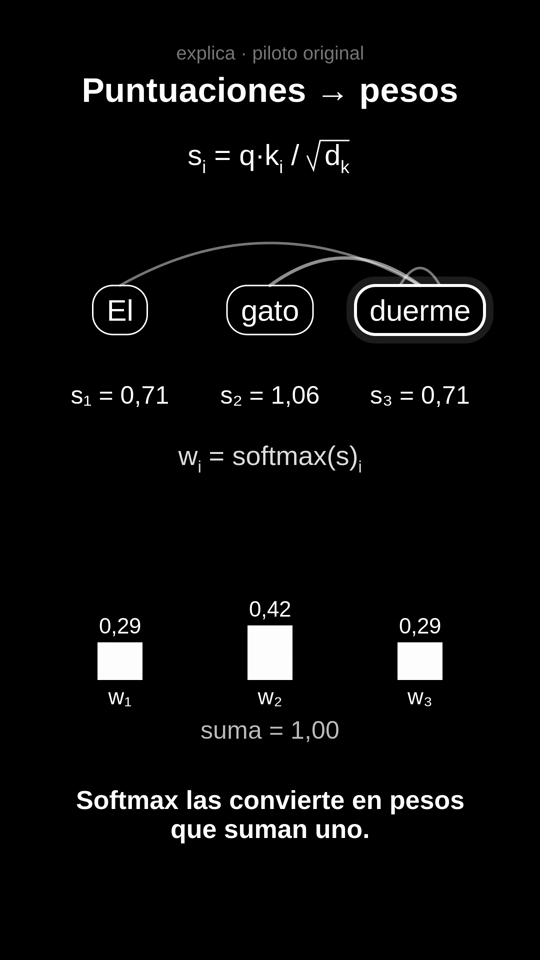

# explica

**Laboratorio local de videos explicativos controlable por agentes.** Un solo núcleo en Python sirve
a la vez una CLI y un servidor MCP (stdio): escenas declarativas con IDs semánticos renderizadas con
pycairo → FFmpeg, timeline multicapa (fondo, escenas, títulos, captions, voz, música, efectos)
compuesto con MLT (`melt`, el mismo motor de Kdenlive), ida y vuelta con proyectos nativos
`.kdenlive`, checkpoints/undo, jobs recuperables y un piloto original de 32 s sobre un paso de atención.

Todo corre en local, sin red, sin servicios de pago. Licencia MIT.

> Estado: v0.1.0. Probado en Linux (Arch/Omarchy, Python 3.13, FFmpeg 9.0.1, MLT 7.40, Kdenlive 26.08)
> y en CI (Ubuntu, Python 3.12/3.13, FFmpeg + melt de apt). El round-trip con la GUI real de Kdenlive 26.08 se
> verificó en un compositor headless privado ([docs/KDENLIVE.md](docs/KDENLIVE.md)). Lo que **no** se ha probado
> está en [docs/LIMITS.md](docs/LIMITS.md); no lo des por hecho.

## Qué hace

| Capa | Qué es | Quién la edita |
|---|---|---|
| `scenes/*.json` | Escenas declarativas: objetos con `id` (texto, fórmula, token, vector, matriz, arco, barra…), animaciones por propiedad, cámara | Agente (`scene_patch`) o humano en el JSON |
| `project.json` | Manifiesto: fps racional, assets con hash y licencia, pistas V1–V4 / A1–A3, clips `[start,end)` en frames, captions, títulos, revisión, historial | Agente (`timeline_patch`) |
| `export/*.kdenlive` | Proyecto Kdenlive nativo (doc 1.1): cortes, niveles, títulos y captions como clips de título editables | Humano en Kdenlive → `kdenlive_sync` |
| `renders/` | Derivados (clips de escena cacheados por hash, previews, frames de evidencia) | Nadie: se regeneran |

Reglas de tiempo: frames enteros, fps racional `num/den`, intervalos `[inicio, fin)`; la conversión a
`in/out` inclusivos de MLT es exacta (`out = fin − 1`), sin redondeos acumulados (`tests/test_timebase.py`).

## Instalación reproducible (Linux)

Requisitos del sistema: `ffmpeg`, `ffprobe`, `melt` (MLT ≥ 7), cabeceras de cairo y una fuente sans
(Liberation Sans o DejaVu Sans). Kdenlive es opcional (solo para la edición humana en GUI).

```bash
# Arch
sudo pacman -S --needed ffmpeg mlt cairo ttf-liberation          # kdenlive opcional
# Ubuntu/Debian
sudo apt install ffmpeg melt libcairo2-dev pkg-config fonts-liberation

git clone https://github.com/Twynzen/explica.git && cd explica
uv venv .venv && uv pip install --python .venv/bin/python -e ".[dev]"   # o: python -m venv .venv && .venv/bin/pip install -e ".[dev]"
.venv/bin/explica capabilities        # mide lo que hay de verdad en esta máquina
.venv/bin/python -m pytest -q         # 54 pruebas; las que necesitan ffmpeg/melt se saltan si faltan
```

Narración de prueba local (opcional, libre): `uv pip install --python .venv/bin/python -e ".[tts]"` y
descarga una voz de Piper (ver [docs/AUDIO.md](docs/AUDIO.md)). Sin ella, el piloto se construye con
duraciones de marcador y sin pista de voz.

## Uso en 2 minutos

```bash
E=.venv/bin/explica
$E -p mi-video init "Mi video"                                  # crea mi-video/project.json
$E -p mi-video scene add examples/scenes/minima.json            # escena declarativa
$E -p mi-video timeline-patch --ops-json '[{"op":"add_clip","track":"V2","clip":{"id":"c1","source":{"kind":"scene","ref":"minima"},"start":0,"in":0,"out":90}}]'
$E -p mi-video frame timeline 45                                # PNG de evidencia (MLT)
$E -p mi-video preview --wait 120                               # mp4 540x960
$E -p mi-video scene patch minima --ops-json '[{"op":"set","path":"objects.title.text","value":"Otro rótulo"}]'
$E -p mi-video undo                                             # vuelve al snapshot anterior
$E -p mi-video export kdenlive                                  # abre export/mi-video.kdenlive en Kdenlive
$E -p mi-video sync-from-kdenlive mi-video/export/mi-video.kdenlive   # trae cortes/títulos editados a mano
$E -p mi-video export bundle                                    # master 1080x1920 + fuentes + stems + QA
```

Toda salida es JSON. Cada operación que escribe toma un checkpoint antes, acepta `--expected-revision`
y `--dry-run`, y devuelve `revision`, `affected_files`, `warnings` y `diff`.

## Control por agente (MCP)

```bash
.venv/bin/explica-mcp --project examples/pilot-atencion      # stdio; ver mcp.example.json
```

Herramientas: `project_guide`, `project_inspect`, `timeline_query`, `media_inspect`, `media_frame`
(devuelve PNG + imagen inline), `audio_segment`, `transcript_query`, `scene_inspect`, `scene_patch`,
`timeline_patch`, `title_set`, `project_checkpoint`, `project_restore` (sin id = undo), `project_history`,
`render_preview`, `job_status`, `job_cancel`, `project_validate`, `project_export`, `kdenlive_sync`,
`capabilities_report`. Guía de una página para el cliente: [`src/explica/guide.md`](src/explica/guide.md).

Comprobado desde una sesión limpia con Claude Code como cliente real (descubrir → guía → inspeccionar →
frame → parche con dry-run → corte → preview → undo): [docs/evidence/A18-mcp-clean-session-client.json](docs/evidence/A18-mcp-clean-session-client.json)
y el log del servidor [A18-mcp-clean-session-server.jsonl](docs/evidence/A18-mcp-clean-session-server.jsonl).
Detalles y límites de cliente en [docs/MCP.md](docs/MCP.md).

## Piloto original: «Atención: un paso» (29,4 s, vertical, español)

Objetivo del plan: 20–30 s. Cada frase se cronometra con su clip de voz medido; la duración total depende de la
voz (Piper no es determinista: ±0,5 s entre construcciones). `pad_frames`, `gap_frames` y `length_scale` en
`explica.pilot.attention.build` la ajustan.

```bash
.venv/bin/python -m explica.pilot.attention examples/pilot-atencion --piper-model .models/piper/es_MX-ald-medium.onnx
.venv/bin/explica -p examples/pilot-atencion export bundle
```

Una cabeza de atención con números de juguete calculados en código y verificados en tests
(`pesos = softmax(q·kᵢ/√d_k)` suman 1; salida = Σ wᵢvᵢ). Guion, storyboard, fuentes y simplificaciones:
[examples/pilot-atencion/README.md](examples/pilot-atencion/README.md). QA del master (−16,0 LUFS,
−3,3 dBTP, 882 frames 1080×1920): [docs/evidence/A17-pilot-bundle-QA-REPORT.json](docs/evidence/A17-pilot-bundle-QA-REPORT.json).



## Documentación

- [docs/ARCHITECTURE.md](docs/ARCHITECTURE.md) — modelo de datos, fuentes de verdad, formatos, timebase.
- [docs/MCP.md](docs/MCP.md) — contrato de herramientas, capacidades requeridas del cliente y alternativas.
- [docs/KDENLIVE.md](docs/KDENLIVE.md) — exportación nativa, qué hace round-trip y qué no, conflictos.
- [docs/AUDIO.md](docs/AUDIO.md) — voz/música separadas, Piper local, loudness, sustitución por grabación humana.
- [docs/RECOVERY.md](docs/RECOVERY.md) — checkpoints, undo, locks, jobs recuperables.
- [docs/ACCEPTANCE.md](docs/ACCEPTANCE.md) — pruebas A01–A22 con evidencia y estado real.
- [docs/LIMITS.md](docs/LIMITS.md) — lo que no está probado o no funciona todavía.
- [docs/SECURITY.md](docs/SECURITY.md) — modelo de amenazas y qué se rechaza.

## Licencias

Código: MIT. Dependencias Python: pycairo (LGPL-2.1/MPL-1.1), mcp (MIT), piper-tts opcional (MIT; las voces
llevan la licencia de su dataset). Herramientas externas invocadas como procesos: FFmpeg (GPL/LGPL según
build), MLT (LGPL), Kdenlive (GPL). El proyecto no redistribuye binarios de ninguna de ellas.
El bundle del piloto no contiene audio ni animaciones de terceros: la música se sintetiza y la narración de
prueba es TTS local reemplazable.
